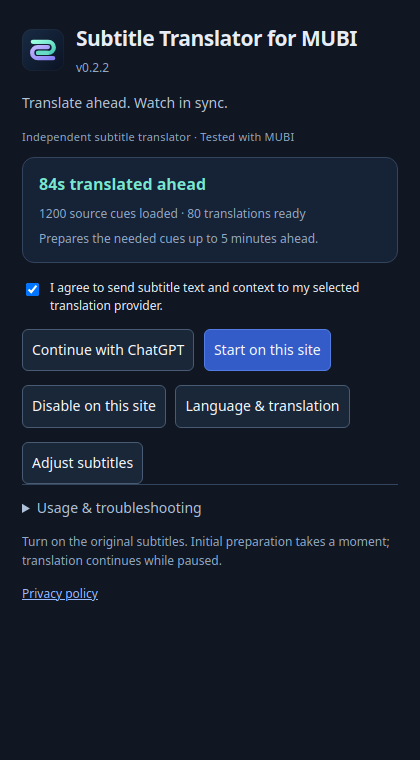

<p align="center"></p>

# Subtitle Translator for MUBI

**Translate ahead. Watch in sync.**

[English](README.md) · [한국어](docs/README.ko.md) · [日本語](docs/README.ja.md) · [简体中文](docs/README.zh-CN.md) · [繁體中文](docs/README.zh-TW.md) · [Español](docs/README.es.md) · [Français](docs/README.fr.md) · [Deutsch](docs/README.de.md) · [Português (Brasil)](docs/README.pt-BR.md) · [Italiano](docs/README.it.md) · [Русский](docs/README.ru.md) · [العربية](docs/README.ar.md) · [हिन्दी](docs/README.hi.md) · [Türkçe](docs/README.tr.md) · [Bahasa Indonesia](docs/README.id.md) · [Tiếng Việt](docs/README.vi.md)

An independent, open-source subtitle translation extension, **tested with MUBI on Windows Chrome**.
Subtitle Translator for MUBI reads existing subtitle timelines, translates dialogue ahead of playback, and shows each translation at its original cue time.
It is not affiliated with or endorsed by MUBI. Other players may work, but they are experimental rather than advertised as supported.



*Interface preview with synthetic subtitle counts; no film or real dialogue is included.*

## What it does

- Fetches a complete subtitle file when available, or prepares segmented subtitles up to five minutes ahead.
- Translates the needed window in batches: eight cues initially, then up to 40 cues / 24,000 characters.
- Displays translations only during dialogue; keeps controls out of the video until you open them.
- Prevents duplicate overlays after reinjection and deduplicates identical overlapping translations.
- Reuses per-cue translations when seeking or reloading.
- Offers English UI by default and 16 interface languages in **Settings → App language**; the translation target is separate.
- Connects directly through official ChatGPT sign-in without a local helper.
- Supports **Codex CLI with your ChatGPT account**, or an experimental **Ollama** adapter on this PC.

This is an early release for technically comfortable users. Legacy Codex CLI and Ollama modes require a separate local helper. The browser-only ChatGPT mode is a tested early preview.
Initial translation and seeking outside the prepared window can take several seconds. Voice transcription is not included.

## Browser-only setup

1. Download the complete release ZIP and extract it to a permanent folder.
2. Open `chrome://extensions` or `edge://extensions`, enable Developer mode, and **Load unpacked → extension/**.
3. Open the extension and choose **Continue with ChatGPT**, then choose it again in the pinned connection tab.
4. Complete the official sign-in and allow use of your ChatGPT plan. Choose an available model and confirm.
5. Choose your translation target in Settings. On MUBI, enable original subtitles and select **Start on this site** after confirming subtitle processing.
6. Reload the video page. **Keep the pinned connection tab open while watching.**

No Python, Codex CLI, native helper or OS-specific application is required in this mode.
Tokens stay only in the connection tab's memory, not browser storage. Account labels, issued client IDs and an opaque host ID are saved for returning sign-ins.
Closing the tab clears local credentials; use **Sign out** for remote session revocation.

The OAuth callback adaptation, long-session renewal and other browsers need wider testing.

## Optional legacy helper setup

1. Download the complete `mubi-subtitle-translator-VERSION.zip` release and extract it to a permanent folder.
2. Open `chrome://extensions` or `edge://extensions`, enable **Developer mode**, and choose **Load unpacked → extension/**.
3. Install Python 3.10+ and [Codex CLI](https://learn.chatgpt.com/docs/codex/cli) on this same PC.
4. Open a terminal in the extracted folder and run the guided setup, using the extension ID shown in your browser:

```sh
python3 native/setup.py --browser chrome --login
```

On Windows, use `python` or `py -3` if `python3` is unavailable. For Edge, use `--browser edge`.
The setup checks prerequisites, registers the helper, and launches the **official Codex sign-in flow**. It does not download software or copy login credentials.
If Codex is already signed in, registration can be reused; `--login` is optional.

5. In **Settings**, choose the target language and a model your account can access; check the helper connection.
6. Open MUBI, enable its original subtitles, open Subtitle Translator for MUBI, accept the subtitle-processing notice and select **Start on this site**.
7. Reload the video page. The popup shows loaded source cues, prepared translations, and the current translated buffer.

You do not need a Chrome Web Store developer account to install from GitHub.
This release has not been submitted to the Chrome Web Store. Chrome/Edge settings, permissions and caches are separate.
After updates, reload the extension and the video page in each browser.

### Ollama instead of Codex

Install Ollama and a suitable model on the browser PC, then register without requiring Codex:

```sh
python3 native/install.py EXTENSION_ID --browser chrome --provider ollama
```

In Settings, select **Ollama**, enter the exact installed model name, and check the helper connection.
The adapter connects only to `127.0.0.1:11434`. A locally running model is needed for on-device inference; Ollama cloud models or your server configuration may forward data.
The adapter protocol and response checks are tested with a simulated backend; real model quality and speed are not yet verified.
Claude, Gemini and other cloud APIs are not implemented in this release. API keys are not collected by the extension.

## Compatibility

| Target | Status |
| --- | --- |
| MUBI / Windows Chrome | Actual timed subtitle capture and pretranslation verified |
| Edge | Code-compatible target; actual playback verification pending |
| Other streaming sites | Experimental; do not assume support |
| Native TextTrack, VTT, SRT, TTML, ASS, JSON3 | Synthetic parser/browser coverage |
| DASH sidecar, TTML SegmentTemplate/SegmentTimeline | Synthetic coverage; MUBI timeline verified |
| DASH SegmentList, MP4 wvtt demuxing | Not implemented |

If a timeline is unavailable, Subtitle Translator for MUBI falls back to visible subtitle text. That mode translates after a cue appears and can lag by the model response time.

## Privacy, permissions and cost

In browser-only ChatGPT mode, subtitles, nearby dialogue and translation preferences go directly to OpenAI using your authorized ChatGPT plan.
Optional Codex CLI and Ollama modes use the local helper; Codex sends to OpenAI and Ollama connects to the local Ollama service.
Translations are cached in browser local storage. Diagnostics remain on the PC and exclude dialogue text.
No Subtitle Translator for MUBI-operated analytics, advertising or translation relay server is used.

The extension is free and open source. Your model provider's charges, subscription limits and hardware requirements still apply.
Token totals cover measured successful requests, not all account activity. See the [privacy policy](docs/PRIVACY.md).

Site terms and content rights still apply. MUBI's terms restrict automated access, content modification and some AI uses; free distribution does not remove those restrictions.
Review the [MUBI terms](https://mubi.com/en/terms_of_service) before use. Subtitle Translator for MUBI does not include film footage, real subtitle datasets, MUBI logos or DRM-decryption functionality.

## Develop

```sh
npm run locales # after editing locale catalogs
npm run lint
npm test
python3 tests/browser_check.py
python3 tests/browser_oauth_check.py
npm run build
```

Language catalogs live in `extension/_locales/`; `scripts/locale-metadata.json` lists the supported interface languages. Regenerate `extension/i18n.js` with `npm run locales` after editing a catalog.

The browser suite requires Python Playwright and Chromium. Unit tests use built-in Node/Python tooling.
The store-upload ZIP contains only the extension; the complete ZIP also includes the local helper. Store publishing requires a registered developer account and review.

[MIT License](LICENSE)
